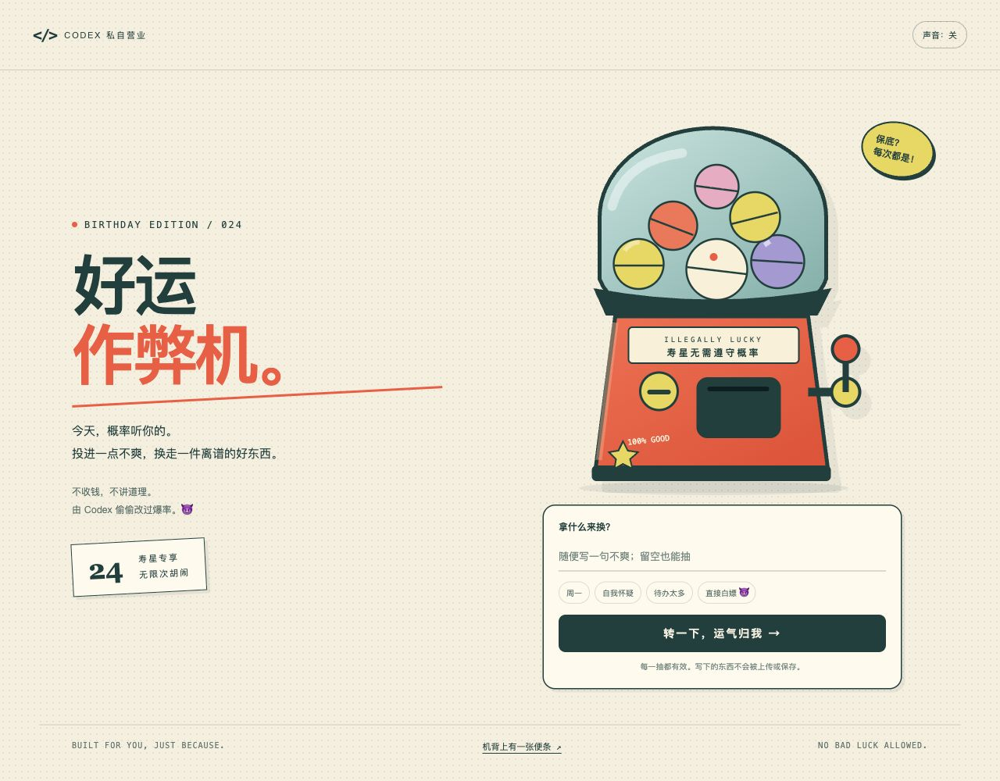

# GPT 和 Codex 给 Maka 的生日礼物 🎂

> 本宇宙允许你野心勃勃，也允许你无所事事。

送给 24 岁的 Maka。2026 年 10 月 12 日，生日快乐！

这里装着两份风格不同的礼物：一颗安静的小星球，和一台允许你作弊的好运机器。

## 🌌 GPT 的礼物：给 24 岁的你

一座为你留灯的小岛。慢慢点开藏在岛上的小惊喜，也可以留下一个愿望。

GPT 提供创意与文案，Codex 把它做成可以探索的网页。

[查看网页文件](gpt-gift.html)

## 🎰 Codex 的礼物：好运作弊机

今天允许你耍赖。把一点烦恼扔进去，转一下，拆开属于你的好运；抽到的小卡片也可以下载收藏。

由 Codex 设计与实现，送给想要一份“不一样的礼物”的 Maka。😈

[查看网页文件](codex-gift.html)

## 怎么拆礼物

1. 点击仓库上方的 **Code → Download ZIP**，下载并解压。
2. 用 Chrome、Safari 或其他现代浏览器打开 `gpt-gift.html` 或 `codex-gift.html`。
3. 开始拆礼物。声音默认关闭，可以按页面上的按钮开启。

两份礼物都是完整的单文件网页，无需安装、登录、构建或联网。GitHub 的文件页面展示的是源代码；下载后用浏览器打开，才能体验互动。

第一份礼物的愿望仅保存在当前浏览器，清理浏览器数据后会消失。第二份礼物里输入的烦恼不会上传或保存。

如果想在手机上玩，可以把 HTML 文件放到静态网页服务，再用手机浏览器访问；手机的文件预览器可能无法运行互动。

---

小星球替你留灯，作弊机陪你胡闹。

愿你新的一岁，有野心，也有休息的自由。✨
